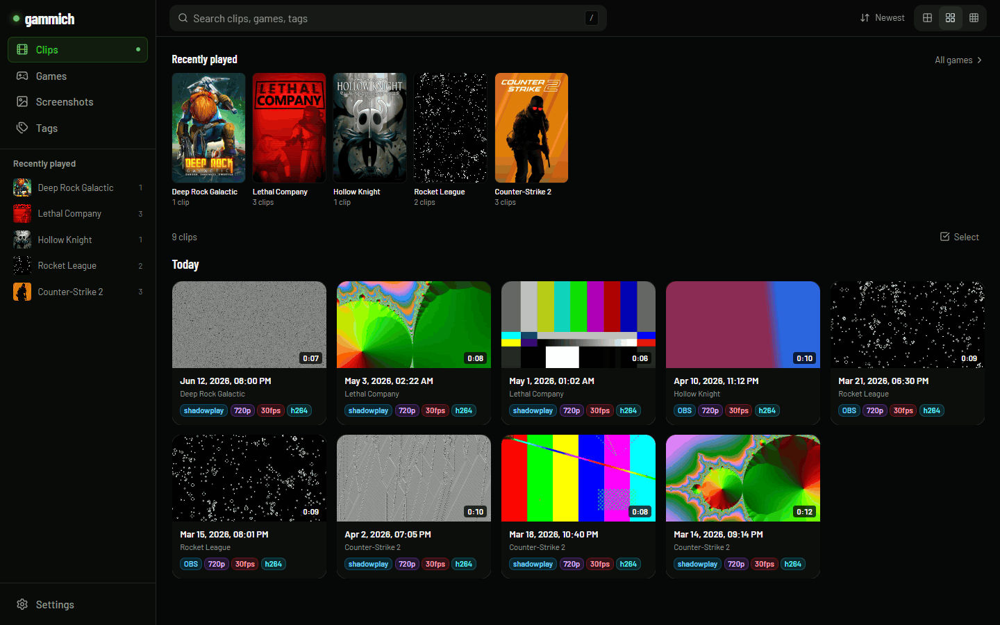
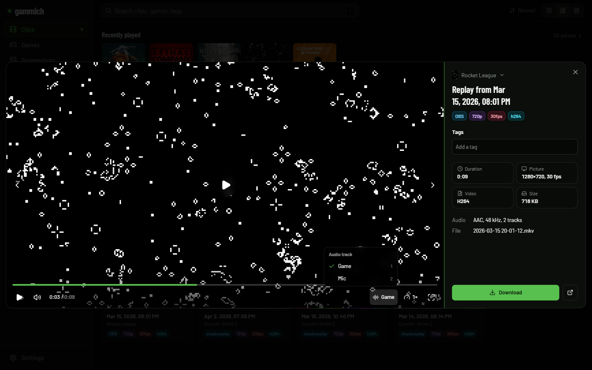
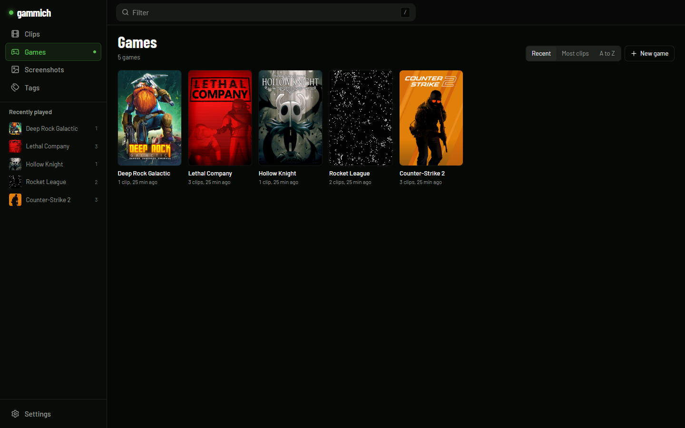

# gammich

A self-hosted web library for your game clip recordings. Point it at the folder
where ShadowPlay, OBS or any recorder drops its videos, and browse them by game
with hover-scrub previews, tags, full-text search and playback with every audio
track, in any browser.



## Features

- **Your files stay untouched.** The recordings folder is mounted read-only;
  downloads return the exact original file. Only small preview images are
  written, to a separate cache.
- **One folder per game.** Each top-level folder becomes a game with its Steam
  cover. New and removed clips are picked up by a scan every 5 minutes.
- **Hover-scrub previews** from a sprite sheet per clip, generated by ffmpeg in
  the background (or on a GPU workstation with `scripts/gen-previews.ps1`).
- **Tags and search.** Automatic tags for resolution, frame rate, codec and
  recorder; your own tags on top; FTS5 search with tag autocomplete; bulk
  tagging and moving.
- **Sound everywhere.** Multi-track recordings show a track picker with the
  track names. Firefox plays MP4s whose index sits at the end of the file and
  OBS PCM audio, both without re-encoding anything: the index is rebuilt in
  memory and PCM audio is decoded per request and played through Web Audio.
- **Screenshots** from the same folders get their own tab.
- A single Go binary with the web UI embedded, SQLite for its state, ffmpeg for
  previews. It runs on a 2-core, 1 GB container.
- English and French UI, picked from the browser language.

| Clip | Games |
| --- | --- |
|  |  |

## Quick start with Docker

```sh
curl -O https://raw.githubusercontent.com/klNuno/gammich/main/compose.yaml
curl -o .env https://raw.githubusercontent.com/klNuno/gammich/main/.env.example
# edit .env: GAMMICH_VIDEOS_DIR and GAMMICH_PASSWORD
docker compose up -d
```

Open http://localhost:8080 and sign in with your password. The first scan runs
at startup; previews fill in over the next minutes.

Or with `docker run`:

```sh
docker run -d --name gammich -p 8080:8080 \
  -e GAMMICH_PASSWORD=change-me \
  -v /path/to/recordings:/videos:ro \
  -v gammich-data:/data -v gammich-cache:/cache \
  ghcr.io/klnuno/gammich:latest
```

Images are published for `linux/amd64` and `linux/arm64`. `latest` follows
releases, `edge` follows the `main` branch.

### Recordings layout

```
recordings/
  Counter-Strike 2/
    Counter-Strike 2 2026.03.14 - 21.14.05.03.DVR.mp4    ShadowPlay
    2026-03-15 20-01-12.mkv                              OBS
  Rocket League/
    ...
```

Any `.mp4`, `.mkv`, `.mov`, `.webm` or `.avi` is a clip, any `.png`, `.jpg`,
`.webp`, `.gif` or `.bmp` a screenshot. The top-level folder names the game;
deeper folders are fine. A NAS share works: mount it on the host (SMB or NFS)
and pass the mount point.

## Access control

| Setup | Reads | Edits |
| --- | --- | --- |
| `GAMMICH_PASSWORD` set | after login | after login |
| `GAMMICH_PROXY_SECRET` set, behind an SSO proxy | open | requests that carry the secret |
| neither | open | disabled |

- **Built-in password**: the simplest option, for a home network or behind any
  reverse proxy. Sessions last 30 days; logins are limited to 5 failures per
  client per 10 minutes. Behind a proxy, set `GAMMICH_TRUSTED_PROXIES` to its
  address so the limit applies per visitor rather than to the proxy itself.
- **SSO proxy** (Authelia, Authentik, oauth2-proxy): the proxy authenticates
  users and adds the `X-Gammich-Proxy-Secret` header. Requests that reach
  gammich's port without the proxy can still read, so keep that port on a
  private network. Example: [`deploy/Caddyfile.example`](deploy/Caddyfile.example).
- Without either, the library is read-only and the UI hides edit controls.

## Configuration

Every option is a flag or an environment variable. Secrets can also be read
from a file with the `_FILE` suffix (Docker secrets).

| Variable | Flag | Default | |
| --- | --- | --- | --- |
| `GAMMICH_VIDEOS` | `-videos` | `/videos` in Docker | recordings root, required |
| `GAMMICH_DB` | `-db` | `data/gammich.db` | SQLite database |
| `GAMMICH_CACHE` | `-cache` | `data/cache` | preview cache |
| `GAMMICH_ADDR` | `-addr` | `:8080` | listen address |
| `GAMMICH_PASSWORD` | `-password` | | built-in login |
| `GAMMICH_PROXY_SECRET` | `-proxy-secret` | | trusted reverse proxy header |
| `GAMMICH_INGEST_TOKEN` | `-ingest-token` | | token for `scripts/gen-previews.ps1` |
| `GAMMICH_PREVIEW_WORKERS` | `-preview-workers` | `1` | ffmpeg preview workers, `0` disables |
| `GAMMICH_FFMPEG` | `-ffmpeg` | `ffmpeg` | ffmpeg binary (ffprobe next to it) |
| `GAMMICH_HWACCEL` | `-hwaccel` | | ffmpeg `-hwaccel` for previews |
| `GAMMICH_TRUSTED_PROXIES` | `-trusted-proxies` | | proxy CIDRs whose `X-Forwarded-For` is used to rate-limit logins per client |
| `GAMMICH_TRUST_LOOPBACK` | `-trust-loopback` | `false` | loopback clients may edit; local dev only |

gammich asks Steam's public store search for game covers, using the folder
names. No other request leaves your server.

### Building previews on a GPU

A large library takes a while on a small server's CPU. With
`GAMMICH_INGEST_TOKEN` set, a Windows machine with an NVIDIA GPU and the same
share mounted can build them and upload them:

```powershell
.\scripts\gen-previews.ps1 -Server http://my-server:8080 `
    -Token $env:GAMMICH_INGEST_TOKEN -VideoRoot 'Z:\Videos' -Limit 5000
```

## Running without Docker

Download a binary from the [releases](https://github.com/klNuno/gammich/releases),
install ffmpeg, then:

```sh
GAMMICH_PASSWORD=change-me ./gammich -videos /path/to/recordings
```

## Development

Needs Go 1.27, Node 24 with pnpm, and ffmpeg.

```sh
make fixtures   # demo library in _fixtures/, built with ffmpeg
make web        # build the UI into internal/staticfs/dist
make dev        # server on http://127.0.0.1:8080 against _fixtures
cd web && pnpm dev   # UI with hot reload, proxies /api to :8080
make check test # gofmt, go vet, svelte-check, go test
```

Layout: `cmd/gammich` (entry point), `internal/api` (HTTP API, auth, streaming,
PCM audio), `internal/scan` (folder scanner), `internal/preview` (ffmpeg
worker), `internal/faststart` (in-memory MP4 index rebuild),
`internal/db` (SQLite migrations and queries), `web/` (SvelteKit UI).

See [CONTRIBUTING.md](CONTRIBUTING.md) and [SECURITY.md](SECURITY.md).

## License

[MIT](LICENSE)
